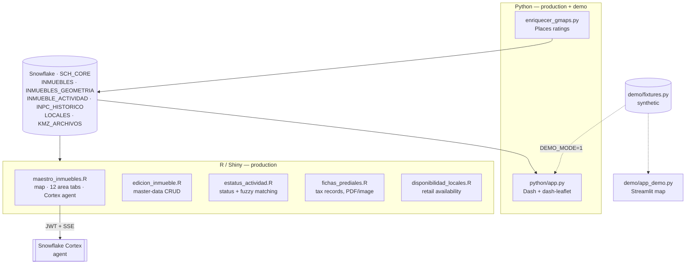

# Property Portfolio — Geospatial Dashboard

> A real estate group's entire property portfolio on one map: surface area measured
> from each parcel's own polygon, acquisition value restated for inflation, and a
> natural-language query box wired to a Snowflake Cortex agent.
> Built twice — R/Shiny and Python/Dash — over the same warehouse.
> **Anonymized portfolio version — all data is synthetic.**

  

**▶ Live demo:** *(pending deploy — the link goes here)*

---

## The problem

Twelve business areas — legal, expansion, operations, finance, marketing and the rest
— each needed a different view of the same properties, and each kept its own copy of
the truth in spreadsheets and folders. Answering "how much land do we hold in this
state, and what is it worth today" meant someone opening files for an afternoon.

Two things made it more than a reporting job:

- **Surface area was unreliable.** The recorded figure was often missing, zero, or
  obviously wrong (a 700,000 m² retail unit). But every property had a mapped
  boundary, and a boundary can be measured.
- **Acquisition price is not current value.** A property bought in 2009 and one bought
  in 2024 cannot be added together as recorded. They have to be restated.

## What I built

An interactive map of the portfolio with per-area views, backed by Snowflake, plus a
second implementation of the map in Python to show the same thing works off the same
warehouse from either stack.

| | |
|---|---|
| **Stack** | R 4.5 · Shiny · Leaflet · `sf` — and Python · Dash · dash-leaflet · shapely · pyproj |
| **Data** | Snowflake: properties, geometries, activity status, INPC, leasable units |
| **Scale** | 300+ properties · 2,700+ leasable units · 12 business-area views |
| **Outcome** | One map replaced the search through scattered files |

---

## Architecture



---

## Design decisions

### Measure the parcel, don't trust the field

`TERRENO_M2` is used only when it is present and plausible — greater than zero and
under 500,000 m². Otherwise the app computes the area from the polygon itself with a
geodesic calculation on the WGS84 ellipsoid (`pyproj.Geod` in Python, `sf` in R), not
a planar approximation, which at Mexican latitudes would be off by a noticeable margin
on the larger parcels.

The result is a number that is always available and always defensible, and a recorded
value that can be audited against it.

### Restate every price to the same date

Acquisition prices are re-expressed using the national consumer price index: the index
today over the index at the deed date. Without it, a portfolio total is a sum of pesos
from fifteen different years, which is not a number.

### One tab per business area, one dataset underneath

Legal, expansion, operations, finance and the other eight each get a tab with the
columns and filters they actually use. They are views over the same query, not
separate reports — so nobody maintains a second version of the truth, and the map, the
table and the export always agree.

### The Cortex agent speaks SSE, so the app had to

`maestro_inmuebles.R` includes a natural-language query box backed by a Snowflake
Cortex agent: ask "which properties are active in this state" and get an answer over
the live data. Two things made it more than an API call — the agent authenticates with
a **JWT signed from the key-pair**, and it answers with a **server-sent event stream**,
not JSON, so the response has to be parsed incrementally (`parsear_sse_cortex`).

### The same map, twice, on purpose

`python/app.py` re-implements the map tab in Dash, reading the same tables with the
same queries. It started as a portability question — could this leave Shiny — and it
is the clearest evidence in this repo that the logic lives in the warehouse and the
queries, not in one framework.

---

## Run the demos

Two of the three run with no credentials.

### The map (Streamlit — this is what gets deployed)

```bash
git clone https://github.com/Paz-RangelR/property-portfolio-geo.git
cd property-portfolio-geo
pip install streamlit pandas pydeck
streamlit run demo/app_demo.py
```

42 synthetic properties across six Mexican cities, filterable by company, state and
use, with occupancy for the retail ones.

### The production Dash app, on synthetic data

```bash
pip install dash dash-leaflet shapely pyproj pandas
DEMO_MODE=1 python python/app.py       # PowerShell: $env:DEMO_MODE="1"
```

`DEMO_MODE=1` swaps the four Snowflake queries for the fixtures. Everything after that
— geometry parsing, geodesic area, the INPC restatement, the merge — is the production
code path, unchanged.

### The R/Shiny apps

These need a warehouse; they are here to be read. With a real Snowflake:

```bash
cp .env.example .env     # fill in
Rscript -e 'shiny::runApp("R/maestro_inmuebles.R")'
```

Login users are read from `APP_USERS` as salted `bcrypt-pbkdf` hashes (see `R/auth.R`):
the repository holds no credentials, and neither does `.env` hold a usable password.
`Rscript tests/test_auth.R` checks the module.

> If the deployed demo is asleep, the first load takes about 40 seconds while the free
> instance wakes up.

---

## About the synthetic geometry

The polygons are invented, but they are not decoration. Each one is an irregular ring
of vertices around a centroid, built in metres and converted to degrees at that
latitude, so `shapely` parses them and `pyproj` measures them — the areas in the demo
are **real measurements of fake parcels**, ranging from about 1,100 m² to 167,000 m².
That is what lets the area logic actually be exercised instead of merely displayed.

---

## Repository layout

```
R/maestro_inmuebles.R          main app: map, 12 area tabs, Cortex agent
R/edicion_inmueble.R           master-data CRUD
R/estatus_actividad.R          activity status, fuzzy matching with stringdist
R/fichas_prediales.R           tax records, PDF and image handling
R/disponibilidad_locales.R     retail availability
R/excel.R                      institutional Excel export
R/auth.R                       shared login: hashed users from APP_USERS
python/app.py                  Dash + dash-leaflet map (runs with DEMO_MODE=1)
python/enriquecer_gmaps.py     Google Places ratings enrichment
demo/fixtures.py               synthetic portfolio with real WGS84 geometry
demo/app_demo.py               the Streamlit demo map
```

---

## Notes on anonymization

This is a real production system, rewritten for public release:

- The group, its companies, properties, addresses, prices, tenants and the warehouse
  topology are **renamed or invented**. The demo cities are deliberately not the
  portfolio's real ones.
- The Snowflake account, the service user and the private-key path come from
  environment variables; see `.env.example`. Nothing is committed.
- Colleagues' email addresses in the original were replaced.
- The original apps kept their login users in the source. Authentication now lives in
  one module, `R/auth.R`, shared by the four apps: users come from the environment,
  passwords are stored only as salted hashes, and comparison is constant-time.
- The 32-state catalogue in `edicion_inmueble.R` is kept: it is a national catalogue,
  it identifies nobody, and removing it would break the form.
- The INPC is a public INEGI index; the demo series is synthetic but shaped like it.

The architecture, the geodesic measurement, the inflation restatement and the Cortex
integration are the real ones.
